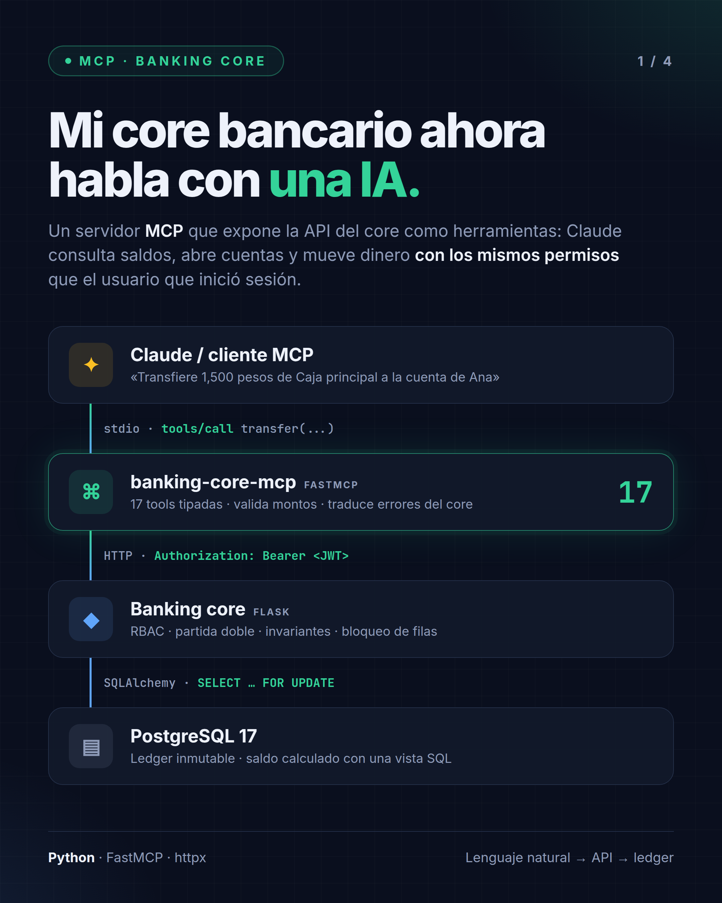
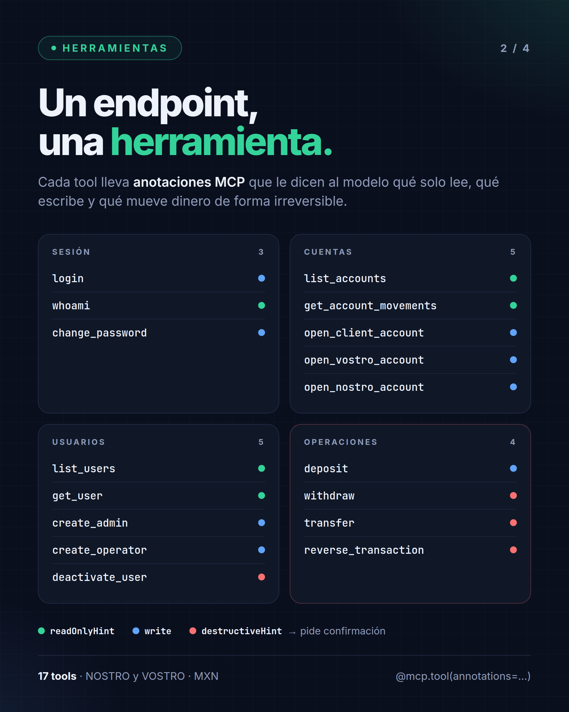
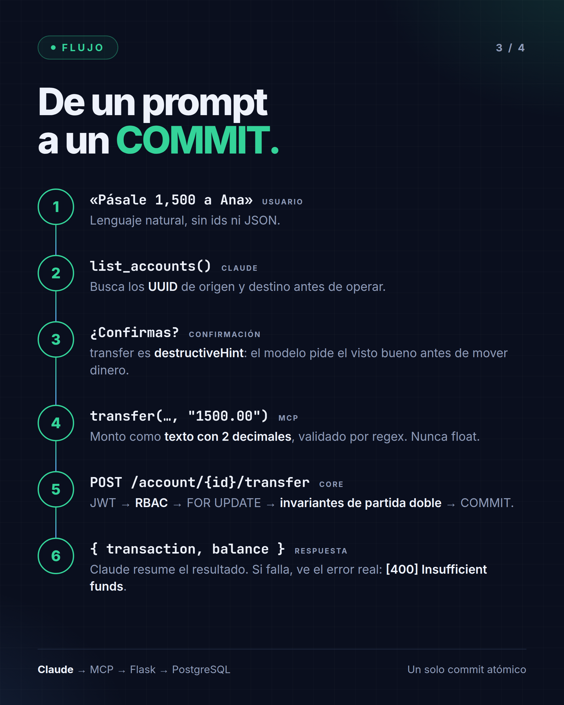
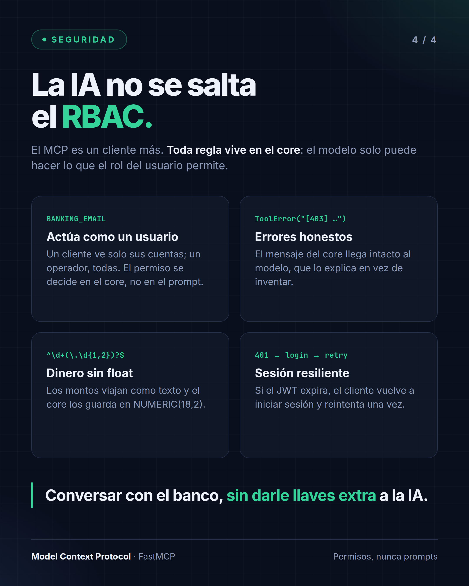

# Banking core MCP

An [MCP](https://modelcontextprotocol.io) server that exposes the HTTP API of the [banking core](../banking-core) as tools, so an assistant like Claude can check balances, open accounts and move money through a conversation.

The server keeps no business rules of its own. Every tool is a thin wrapper over one endpoint of the core, and it runs **with the permissions of the logged-in user**: the core's RBAC decides what the assistant can see and do, never the prompt.



## Contents

- [How it works](#how-it-works)
- [Getting started](#getting-started)
- [Connecting it to Claude](#connecting-it-to-claude)
- [Tools](#tools)
- [Session and authentication](#session-and-authentication)
- [Errors](#errors)
- [Amounts](#amounts)
- [Life of a transfer](#life-of-a-transfer)
- [Project layout](#project-layout)

## How it works

```
Claude (MCP client)
   │  stdio · tools/call transfer(...)
   ▼
banking-core-mcp  (FastMCP · main.py)
   │  validates the arguments, turns core errors into ToolError
   ▼
BankingClient     (httpx · banking_client.py)
   │  HTTP · Authorization: Bearer <JWT>
   ▼
Banking core      (Flask)  →  RBAC · double entry · invariants · row locking
   ▼
PostgreSQL 17
```

There are two layers:

| File | Role |
|---|---|
| `main.py` | Declares the MCP server and its 17 tools with FastMCP. Each tool has typed, documented arguments (Pydantic `Annotated` fields), MCP annotations, and a one-line body that calls the client. |
| `banking_client.py` | Async HTTP client for the core. Keeps the JWT, logs in again when it expires, and turns any error response into a `BankingError` carrying the HTTP status and the core's `error` message. |

The server runs over **stdio**: the MCP client starts `python main.py` as a subprocess and talks to it over stdin/stdout. The server sends its `instructions` to the model when the session starts. They describe the domain (NOSTRO and VOSTRO accounts, MXN, amounts as strings) and ask the model to confirm with the user before any operation that moves money.

## Getting started

Requirements: Python 3.12 and the banking core running (`make up` in `../banking-core`, at `http://localhost:8080` by default).

```bash
python3 -m venv venv
venv/bin/pip install -r requirements.txt

cp .env.example .env    # and fill in the user the MCP logs in with
```

### Environment variables

Read from `.env` next to `main.py`, if it exists, or from the environment.

| Variable | Use |
|---|---|
| `BANKING_API_URL` | Core URL, `http://localhost:8080` by default |
| `BANKING_EMAIL` | User the server logs in with |
| `BANKING_PASSWORD` | That user's password |

**Choose the user carefully.** The assistant gets exactly that user's permissions: with a `CLIENT` it only sees and operates on that client's own accounts; with an `OPERATOR` or `ADMIN` it reaches every account. The credentials are optional. Without them, the assistant has to call the `login` tool before anything else.

## Connecting it to Claude

**Claude Code:**

```bash
claude mcp add banking-core -- /absolute/path/to/banking-core-mcp/venv/bin/python /absolute/path/to/banking-core-mcp/main.py
```

**Claude Desktop** (`claude_desktop_config.json`):

```json
{
  "mcpServers": {
    "banking-core": {
      "command": "/absolute/path/to/banking-core-mcp/venv/bin/python",
      "args": ["/absolute/path/to/banking-core-mcp/main.py"]
    }
  }
}
```

The `.env` file is found next to `main.py`, so the client's working directory does not matter. To try the tools without an assistant, use the MCP Inspector: `venv/bin/fastmcp dev inspector main.py` (it needs Node.js).

## Tools



Each tool corresponds to one endpoint of the core.

### Session

| Tool | Endpoint | Description |
|---|---|---|
| `login` | `POST /user/login` | Logs in as another user. The following tools act with that user's permissions. Returns the email, the role and `must_change_password`. |
| `whoami` | `GET /user/{id}` | Profile of the logged-in user. Logs in with the `.env` credentials first if there is no session yet. |
| `change_password` | `POST /user/password` | Changes the logged-in user's password. It is the only operation the core allows while `must_change_password` is true. |

### Users

| Tool | Endpoint | Description |
|---|---|---|
| `list_users` | `GET /user/` | Every user, oldest to newest (admin only). |
| `get_user` | `GET /user/{id}` | Profile of a user by id. |
| `create_admin` | `POST /user/admin` | Creates an `ADMIN` user. |
| `create_operator` | `POST /user/operator` | Creates an `OPERATOR` user. |
| `deactivate_user` | `POST /user/deactivate` | Deactivates a user by email: they can no longer log in. |

### Accounts

| Tool | Endpoint | Description |
|---|---|---|
| `list_accounts` | `GET /account/` | Accounts with holder and current balance. The model uses it to find account ids before operating. |
| `get_account_movements` | `GET /account/{id}/balance` | Movement history with the balance after each movement. |
| `open_client_account` | `POST /account/client` | Signs up a `CLIENT` user together with their first VOSTRO account. |
| `open_vostro_account` | `POST /account/vostro` | Additional VOSTRO account for an existing client. |
| `open_nostro_account` | `POST /account/nostro` | NOSTRO account (the bank's own). |

### Operations

| Tool | Endpoint | Description |
|---|---|---|
| `deposit` | `POST /account/{id}/deposit` | Deposits external money into an account. |
| `withdraw` | `POST /account/{id}/withdrawal` | Withdraws money; fails if the balance is not enough. |
| `transfer` | `POST /account/{id}/transfer` | Transfers between two accounts of the bank. |
| `reverse_transaction` | `POST /account/transaction/{id}/reversal` | Fully reverses a deposit, withdrawal or transfer with a new `REVERSAL` transaction. |

### Annotations

Every tool declares [MCP annotations](https://modelcontextprotocol.io/specification/2025-06-18/server/tools#tool-annotations) that tell the client what kind of action it is. Clients use them to decide when to ask the user for approval:

| Annotation | Tools |
|---|---|
| `readOnlyHint` (read-only, idempotent) | `whoami`, `list_users`, `get_user`, `list_accounts`, `get_account_movements` |
| Write, not destructive | `login`, `change_password`, `create_admin`, `create_operator`, the three account openings, `deposit` |
| `destructiveHint` | `deactivate_user`, `withdraw`, `transfer`, `reverse_transaction` |

All of them set `openWorldHint: false`: they only touch the core, never the outside world. Ids are typed as `UUID`, so a malformed id is rejected before any request reaches the core.

## Session and authentication

`BankingClient` handles the core's JWT so that the tools never deal with tokens:

1. **Lazy login.** No request is sent at startup. The first tool call logs in with `BANKING_EMAIL` and `BANKING_PASSWORD` and keeps the token.
2. **Bearer token.** Every request carries `Authorization: Bearer <JWT>`.
3. **Expired token.** If the core answers `401` and there is a stored password, the client logs in again and retries the request **once**. A second `401` is returned as an error.
4. **Switching users.** The `login` tool replaces the stored credentials, so all following calls run as the new user, including the automatic re-login.
5. **Changing the password.** `change_password` also updates the stored password, so a later re-login still works. The `.env` file is not modified.

To learn the role and user id, the client decodes the token's payload (`sub`, `role`) **without verifying the signature**. This is only informative: the core verifies the token on every request.

## Errors

The core answers errors as `{"error": "<message>"}`. The client raises `BankingError(status, message)`, and `main.py` re-raises it as a FastMCP `ToolError` with the text `[<status>] <message>`. The model sees the core's exact message and can explain it, instead of guessing:

| Case | What the model sees |
|---|---|
| Not enough balance | `[400] Insufficient funds` |
| Missing permission for the user's role | `[403] …` |
| No credentials in `.env` and no `login` | `[401] No credentials: set BANKING_EMAIL and BANKING_PASSWORD or call the login tool` |
| Core down or unreachable | `[503] Cannot reach the banking core at http://localhost:8080: …` |

Every request has a 15-second timeout.

## Amounts

Money never goes through a `float`. Amounts are strings in MXN, greater than zero, with at most two decimals (`"1500.00"`), validated by the tool schema with the pattern `^\s*\d+(\.\d{1,2})?\s*$`. The tool strips whitespace and sends the string as is. The core parses it to `Decimal` and stores it as `NUMERIC(18,2)`.

## Life of a transfer



1. The user asks in natural language: *"Transfer 1,500 pesos from Caja principal to Ana's account."*
2. The model calls `list_accounts` to find the ids of both accounts.
3. `transfer` is destructive, and the server instructions ask the model to confirm before moving money, so it asks the user.
4. The model calls `transfer(account_id, destination_account_id, "1500.00")`. The schema validates the UUIDs and the amount.
5. The client sends `POST /account/{id}/transfer` with the JWT. The core authenticates the user, checks the permission for that account's scope, locks both ledgers with `SELECT … FOR UPDATE`, validates the double-entry invariants and saves everything in a single commit.
6. The tool returns the transaction and the new balance of the source account, or the core's error, and the model summarizes it to the user.



## Project layout

```
banking-core-mcp/
├── main.py              # MCP server: instructions, annotations and the 17 tools
├── banking_client.py    # Async HTTP client: JWT session, re-login on 401, errors
├── requirements.txt     # fastmcp, python-dotenv, httpx2
├── .env.example         # BANKING_API_URL, BANKING_EMAIL, BANKING_PASSWORD
└── img/                 # Diagrams (img/src has the HTML they are rendered from)
```
